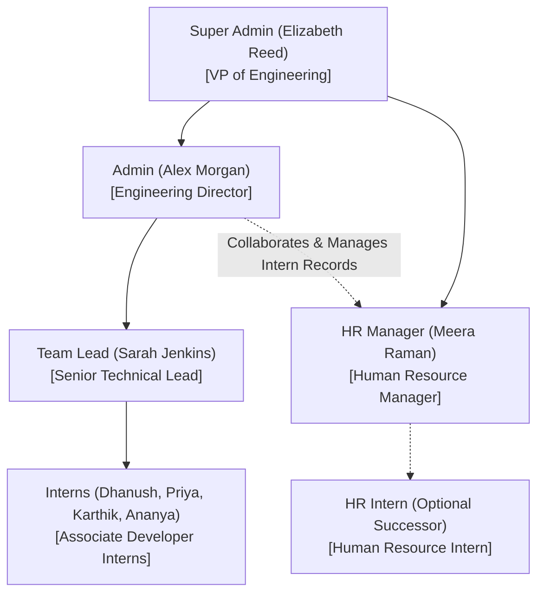

# Ingage Task Tracking System — Codebase Summary & Architecture Specification

> **File**: `.gemini/GEMINI.md`  
> **Project**: Ingage Task Tracking System with CQRS Architecture  
> **Date Generated**: November 18, 2026  
> **Scope**: Exclusive architectural & implementation audit of `backend/` and `frontend/`

---

## 1. Executive Summary & Architecture Overview

The **Ingage Task Tracking System** is an enterprise-grade web application engineered for project management, organizational hierarchy enforcement, role-based task delegation, real-time employee presence tracking, and intern lifecycle administration.

### Architectural Core
* **Pattern**: **CQRS (Command Query Responsibility Segregation)** separating state-mutating commands from high-throughput read queries.
* **Backend Framework**: **FastAPI** (Python 3.13) running on Uvicorn ASGI server with asynchronous WebSocket handlers and background tasks.
* **Database & ORM**: **PostgreSQL** relational database orchestrated via **SQLAlchemy ORM** and connection pooling.
* **Security & Authentication**: **OAuth2 JWT Bearer Tokens** with Argon2 / Bcrypt password hashing and instant role-based Single Sign-On (SSO).
* **Real-Time Communication**: Bidirectional **WebSockets** (`/api/ws/presence`) and Server-Sent Events (**SSE**) for live duty presence verification (`Available` vs `NA`) and notifications.
* **Periodic Services**: Background asyncio service executing automated **8-minute availability checks** with live WebSocket broadcast cycles.
* **Frontend Architecture**: **React 19** with **Vite**, **Tailwind CSS**, and **Lucide React** icons, providing responsive tabular data grids, Kanban boards, and organizational charts.

---

## 2. Organizational Hierarchy & Governance Rules

The entire business logic in both backend and frontend is governed by 4 fundamental organizational hierarchy rules:



### Hierarchy Rules Specification
1. **Rule 1: `Super_Admin -> Admin -> Team_Lead -> Intern`**  
   - Super Admin holds top-level authority over the operational engineering pipeline.
2. **Rule 2: `Admin -> Team_Lead -> Intern`**  
   - Admins oversee technical leads and interns. Feature parity: Super Admin and Admin also hold HR access privileges to view and manage intern records.
3. **Rule 3: `Team_Lead -> Intern`**  
   - Team Leads directly manage, mentor, and allocate project tasks to Interns.
4. **Rule 4: `Super_Admin -> HR`**  
   - HR reports directly to Super Admin.
   - Predecessor: Super Admin.
   - Successor: HR has **0 successors by default**. If needed, Super Admin and Admin may create/assign successor accounts under HR (e.g., `hr_intern` or roles relating to HR).
   - **HR Successor Count Alignment**: The successor count for HR does **not align with all tasks**; it strictly aligns with `(super_admin -> hr)` or `(super_admin -> hr -> hr_intern)` or `(super_admin -> any_roles_relate_with_hr)`.
   - **Intern Exclusion**: Existing engineering interns are strictly excluded from the HR task allocation flow and task views.

---

## 3. Backend Architecture (`backend/`)

### Directory Structure
```
backend/
├── app/
│   ├── api/                      # REST & WebSocket API Routers
│   │   ├── auth.py               # Authentication & SSO endpoints
│   │   ├── dashboard.py          # Dashboard analytics & presence stats
│   │   ├── intern_records.py     # HR/Admin intern documentation
│   │   ├── notifications.py      # Notification queries & read status
│   │   ├── presence.py           # WebSocket endpoint & 8-min service check
│   │   ├── projects.py           # Project CRUD & analysis
│   │   ├── settings.py           # User profile & duty status
│   │   ├── tasks.py              # Task CRUD, Kanban, & status updates
│   │   └── team.py               # Hierarchy & assignees directory
│   ├── core/                     # Infrastructure & Core Utilities
│   │   ├── config.py             # App settings & environment configurations
│   │   ├── database.py           # SQLAlchemy engine & session factory
│   │   ├── notification_broadcaster.py # SSE notification broadcaster
│   │   ├── security.py           # Password hashing & JWT generation/decoding
│   │   └── websocket_manager.py  # Live WebSocket presence & 8-min service manager
│   ├── cqrs/                     # CQRS Pattern Implementation
│   │   ├── commands/             # State-mutating command definitions
│   │   │   ├── notification_commands.py
│   │   │   ├── task_commands.py
│   │   │   └── user_commands.py
│   │   ├── handlers/             # CQRS Handlers
│   │   │   ├── command_handlers.py # Transactional command execution
│   │   │   └── query_handlers.py   # Scoped read query execution
│   │   └── queries/              # Read query definitions
│   │       ├── dashboard_queries.py
│   │       ├── notification_queries.py
│   │       ├── task_queries.py
│   │       ├── team_queries.py
│   │       └── user_queries.py
│   ├── models/                   # Data Models
│   │   ├── domain.py             # SQLAlchemy database entities
│   │   └── schemas.py            # Pydantic request/response contracts
│   ├── services/                 # Application Services
│   │   └── notification_cleanup_service.py # 90-day retention cleanup & Sunday/Monday 6AM scheduler
│   └── seed.py                   # Initial database seeder
├── main.py                       # FastAPI application & lifespan manager
└── requirements.txt              # Python library dependencies
```

### Core Backend Modules & Workflows

#### 1. Lifespan & 8-Minute Periodic Service (`backend/main.py`)
- Initializes PostgreSQL database and executes `seed_database()`.
- Spawns background asyncio task `periodic_8min_presence_service()`:
  - Sleeps for 480 seconds (8 minutes).
  - Triggers `ws_manager.run_periodic_service_cycle()` to audit employee presence and broadcast live availability (`Available` vs `NA`) to all connected WebSocket clients.
- Registers API routers with `/api` prefix and sets up CORS middleware.

#### 2. Domain Models (`backend/app/models/domain.py`)
- `User`: Core authentication record (`id`, `email`, `password_hash`, `role`, `status`, `current_status`, `last_login_at`).
- `UserProfile`: Detailed employee metadata (`employee_id`, `intern_id`, `staff_category`, `designation`, `department`, `reporting_manager_id`, `mobile`, `skills`, `profile_photo`).
- `Project`: Project metadata (`name`, `description`, `client_name`, `department`, `start_date`, `end_date`, `status`).
- `Task`: Task entity (`title`, `description`, `project_id`, `assigned_by_id`, `priority`, `status`, `start_date`, `due_date`, `estimated_hours`, `progress`).
- `TaskAssignment`: Many-to-many junction linking `Task` and `User`.
- `Notification`: In-app notification (`user_id`, `title`, `message`, `type`, `is_read`, `created_at`).
- `InternRecord`: Comprehensive documentation record managed by HR/Admin (`full_name`, `college_name`, `mentor_name`, `joining_date`, `relieving_date`, `performance_score`, `stipend_amount`, `nda_status`, `certificate_issued`).
- `ServiceExecutionState`: Tracks operational status, enabled flag, last execution timestamp, and statistics for background application services.
- `ServiceExecutionLog`: Detailed audit trail logging execution timestamp, trigger type, scanned count, deleted count, and threshold date for retention service runs.

#### 3. Notification Retention Application Service (`backend/app/services/notification_cleanup_service.py`)
- **Table Target**: `public.notifications`
- **Scanning & 90-Day Verification**:
  - Scans every row in `public.notifications`.
  - Verifies the timestamp on the `created_at` column.
  - Rows where `created_at` has **crossed 90 or more days** (`created_at <= now - 90 days`) are deleted completely from the database.
  - Rows with `created_at` under 90 days are strictly preserved.
- **Execution Schedule & Fallback Rules**:
  1. **Primary Schedule**: Executes **every Sunday**.
  2. **Fallback / Catch-up Schedule**: If the service is **disabled** or **not executed on Sunday** (e.g., server offline or maintenance), it re-executes the **next day (Monday) morning at 6:00 AM**.
  3. **Guaranteed Single Execution**: Prevents duplicate executions on the same Sunday or duplicate Monday retries.
- **Background Scheduler Task**:
  - Runs inside `main.py`'s FastAPI `lifespan` as `notification_cleanup_background_scheduler()` checking every 60 seconds.
- **API Endpoints**:
  - `GET /api/notifications/service/status`: Full telemetry, next scheduled run, table statistics, and recent execution history.
  - `POST /api/notifications/service/execute`: Manually trigger 90-day retention cleanup.
  - `POST /api/notifications/service/toggle`: Enable or disable the cleanup service.
  - `GET /api/notifications/service/logs`: Query audit execution logs.
- **CLI Runner**:
  - `python -m app.services.notification_cleanup_service --run` (or `--status`, `--enable`, `--disable`).

#### 3. WebSocket Presence & Periodic Service (`backend/app/core/websocket_manager.py`)
- `WebSocketPresenceManager`: In-memory live session registry mapping `user_id -> Set[WebSocket]`.
- Dynamic Verification: When a socket connects, `broadcast_presence(is_available=True, "Available")` is dispatched. When all sockets for a user disconnect, `broadcast_presence(is_available=False, "NA")` is dispatched.
- `run_periodic_service_cycle()`: Broadcasts a `"presence_service_cycle"` message every 8 minutes containing verified active user IDs.
- Endpoint `/api/presence/service-check` allows manual or scheduled triggers via REST POST/GET.

#### 4. CQRS Command Handlers (`backend/app/cqrs/handlers/command_handlers.py`)
- `handle_login` & `handle_sso_login`: Authenticates credentials or role-based SSO, generates JWT token, updates `last_login_at`, and returns profile payload.
- `handle_create_task`: Validates project existence, dates, and assignees. **Enforces HR policy**: Automatically excludes engineering interns from HR task allocations.
- `handle_update_task_details`: Updates task attributes and re-allocates assignees, strictly stripping intern IDs if modified by HR.
- `handle_create_user`: Validates email uniqueness and enforces hierarchy creation constraints (Admins can only provision successor roles: HR Manager, Team Lead, Intern).

#### 5. CQRS Query Handlers (`backend/app/cqrs/handlers/query_handlers.py`)
- `handle_get_dashboard_stats`:
  - Computes work metrics (Completed, In Progress, Backlog, Overdue, Under Review).
  - Builds `team_members_list` for **each role** according to the hierarchy rules.
  - Verifies presence using `ws_manager.is_user_available(user_id)` or broadcaster session.
  - Sorts employees in **Top-Bottom Order Format** (Available at top, NA at bottom).
  - Resolves `hierarchy_flow`, `predecessor_name`, `employee_count`, and `successor_account_available`.
- `handle_get_tasks` & `handle_get_board_tasks`:
  - Enforces hierarchy scoping via `get_user_and_successor_ids`.
  - For HR: Excludes tasks assigned to engineering interns (`~Task.id.in_(intern_subq)`).

---

## 4. Frontend Architecture (`frontend/`)

### Directory Structure
```
frontend/
├── src/
│   ├── api/
│   │   └── client.js             # Axios API client with JWT interceptor & services
│   ├── components/
│   │   ├── BrandLogo.jsx         # Ingage brand logo & styling
│   │   ├── Navbar.jsx            # Top bar with user profile, duty status, & notification bell
│   │   ├── NotificationDrawer.jsx# Slide-over notification panel with SSE connection
│   │   ├── ProjectAnalysisModal.jsx # Detailed project breakdown modal
│   │   ├── Sidebar.jsx           # Role-based collapsible navigation
│   │   ├── TaskDetailModal.jsx   # Task viewer & quick status updater
│   │   └── TaskModal.jsx         # Create/edit task modal with successor tick allocation
│   ├── context/
│   │   └── AuthContext.jsx       # Global authentication state & SSO methods
│   ├── pages/
│   │   ├── DashboardPage.jsx     # Workspace dashboard & 8-min availability section
│   │   ├── InternRecordsPage.jsx # HR & Admin intern database portal
│   │   ├── LoginPage.jsx         # Authentication screen with one-click SSO buttons
│   │   ├── SettingsPage.jsx      # Profile settings & duty status toggling
│   │   ├── TasksPage.jsx         # Tabular, Kanban Board, & Project Analysis views
│   │   └── TeamPage.jsx          # Organizational chart & team directory
│   ├── App.jsx                   # Main layout shell & view controller
│   ├── index.css                 # Global Tailwind styles & custom animations
│   └── main.jsx                  # React application entrypoint
├── package.json
└── vite.config.js
```

### Key Frontend Views & Features

#### 1. Dashboard Page (`frontend/src/pages/DashboardPage.jsx`)
- **Hero & Metrics Strip**: Real-time counters for Total Tasks, Completion Rate, Completed, In Progress, and Overdue tasks.
- **Priority Breakdown & Timeline**: Visual distribution of Low, Medium, High, and Critical tasks with chronological due-date ordering.
- **Time Sheets Card**: Displays weekly tracked hours (e.g. `24.0 / 40.0 hrs`) and role-based approval badges.
- **Directly Below Time Sheets — Team Members Availability & Successor Accounts**:
  - Presented according to organizational hierarchy. Disappears completely when logged in as an **intern** (`role === 'intern'`), while remaining visible for all other roles (**Super Admin**, **Admin**, **Team Lead**, **HR**).
  - **8-Minute Availability Service Bar**: Displays pulsing status dot, live countdown timer (`Next in MM:SS`), timestamp of last service hit, and a manual `"Hit Service Now"` button (active only when visible).
  - **Top-Bottom Order Format**: Employees currently online via WebSocket (`is_available === true`) are sorted at the **TOP**; offline employees (`is_available === false`) appear at the **BOTTOM**.
  - **HR Hierarchy Flow Banner**: Details `(super_admin -> hr)` with `0` successors when no HR subordinates are assigned.

#### 2. Tasks Page (`frontend/src/pages/TasksPage.jsx`)
- **Three Operation Modes**:
  1. **Tabular Mode**: Sortable consecutive table headers (Task ID, Task Title, Project, Priority, Status, Due Date, Est. Hours, Assigned By), local search, status filters, and pagination (5 per page).
  2. **Kanban Board Mode**: Drag-and-drop / quick status shift columns (Backlog, In Progress, Under Review, Completed, Overdue).
  3. **Project Analysis Mode**: Multi-dimensional project reporting (completion %, overdue counts, employee contribution breakdown). Disappears for Intern role.
- **Successor Scoping & HR Policy**:
  - For non-interns: Toggle between `Tasks I Allocated` (expanded per assignee) and `Successor Tasks` (distinct task IDs).
  - For HR: Successor count strictly displays `0` (or count of HR-related successors). Does **not align with all tasks**. All engineering intern tasks are excluded.

#### 3. Task Modal (`frontend/src/components/TaskModal.jsx`)
- Inline project creation capability with immediate dropdown selection.
- Date validation: Ensures `due_date >= start_date`.
- **Successor Tick Allocation (✓)**: Multi-selection interface for assignees.
- **HR Protection**: Strictly filters out engineering interns from the assignable list and blocks any intern assignment if initiated by HR.

#### 4. Intern Records Portal (`frontend/src/pages/InternRecordsPage.jsx`)
- Dedicated administration view for HR and Admin roles.
- Features: Add intern record, edit records, filter by department/status, search by name/college/mentor, download CSV/JSON reports, and generate sample data.

---

## 5. Seed Database & Test Credentials

The database comes pre-seeded with 5 hierarchy levels and realistic project records:

| Role | Name | Email | Password | Predecessor | Successors |
| :--- | :--- | :--- | :--- | :--- | :--- |
| **Super Admin** | Elizabeth Reed | `superadmin@ingage.com` | `admin123` | None (Top Level) | Admins, HRs, Team Leads, Interns (8) |
| **Admin** | Alex Morgan | `admin@ingage.com` | `admin123` | Super Admin | HRs, Team Leads, Interns (6) |
| **Team Lead** | Sarah Jenkins | `teamlead@ingage.com` | `admin123` | Admin | Interns (4) |
| **HR Manager** | Meera Raman | `hr@ingage.com` | `admin123` | Super Admin | 0 (or HR Interns if created) |
| **Intern** | Dhanush A | `drickcurve123@gmail.com` | `admin123` | Team Lead | None (0) |
| **Intern** | Priya Sharma | `priya.sharma@ingage.com` | `admin123` | Team Lead | None (0) |
| **Intern** | Karthik S | `karthik.s@ingage.com` | `admin123` | Team Lead | None (0) |
| **Intern** | Ananya Rao | `ananya.rao@ingage.com` | `admin123` | Team Lead | None (0) |

*Pre-seeded Projects*: `Edutech LMS Platform`, `Ingage Task Tracking System`, `Rezov Analytics Suite`.

---

## 6. Execution & Verification Runbook

### Starting the Backend
```bash
cd backend
$env:PYTHONPATH='.'
& "venv\Scripts\python.exe" -m uvicorn main:app --host 127.0.0.1 --port 8000 --reload
```

### Starting the Frontend
```bash
cd frontend
npm run dev
# Or build for production:
npm run build
```

### Key Verification Endpoints
- **API Health Check**: `GET http://127.0.0.1:8000/api/health`
- **8-Min Periodic Service Check**: `POST http://127.0.0.1:8000/api/presence/service-check`
- **WebSocket Presence Endpoint**: `ws://127.0.0.1:8000/api/ws/presence?token=<JWT_TOKEN>`
- **Dashboard Stats**: `GET http://127.0.0.1:8000/api/dashboard/stats`
- **Assignable Team Directory**: `GET http://127.0.0.1:8000/api/team/assignees`
